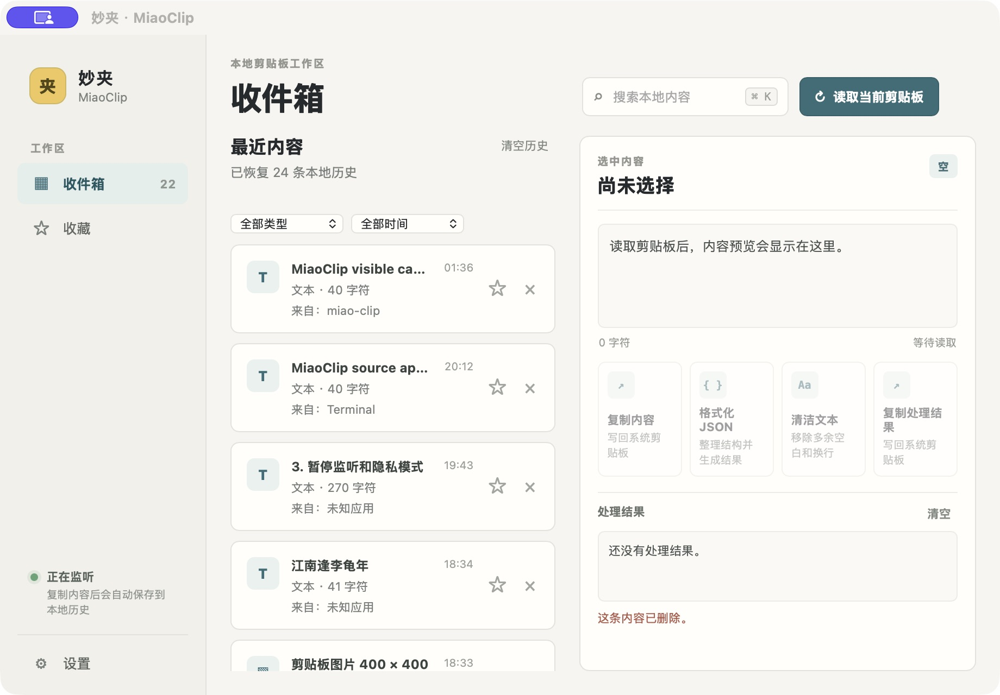
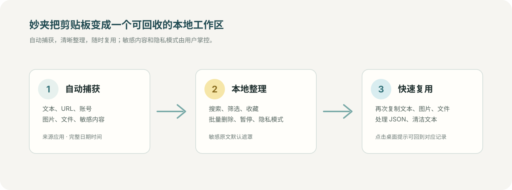
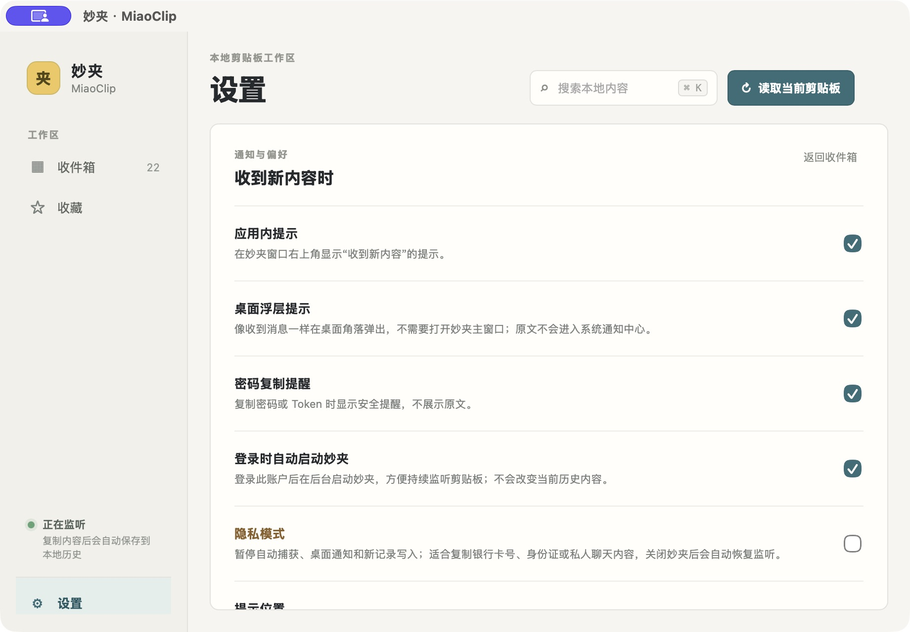
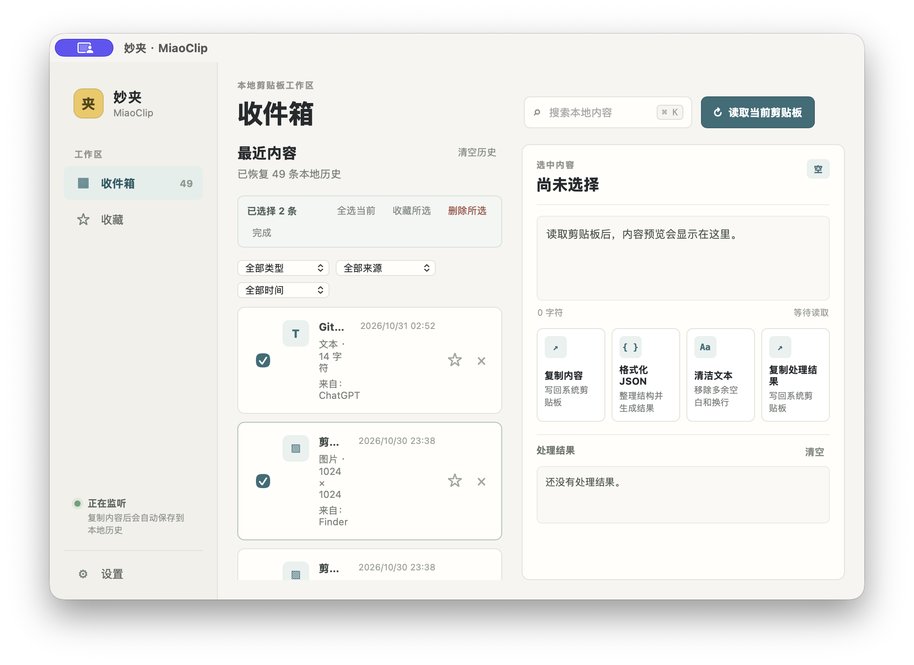
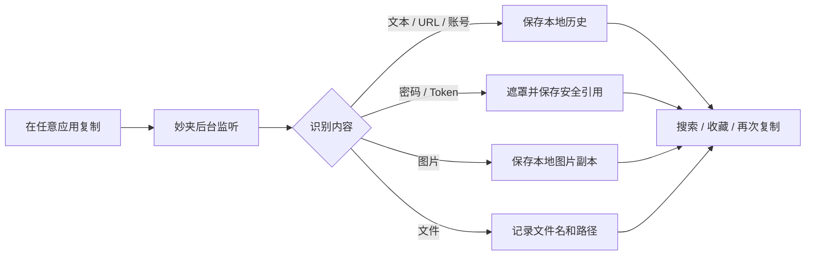

<div align="center">
  

  # 妙夹 · MiaoClip

  <p>把复制过的内容，变成一个找得回、看得懂、用得上的本地工作区。</p>

  <p>
    <a href="https://github.com/strawberry-little-bear/miao-clip/actions/workflows/ci.yml"></a>
    
    
    
    
  </p>

  <p>
    <a href="#30-秒上手">30 秒上手</a> ·
    <a href="#功能速览">功能速览</a> ·
    <a href="#界面预览">界面预览</a> ·
    <a href="#下载试用版">下载试用版</a> ·
    <a href="#隐私与数据">隐私与数据</a> ·
    <a href="#参与贡献">参与贡献</a>
  </p>
</div>

<p align="center">
  
</p>

<p align="center"><sub>复制一次，自动留下来；需要时搜索、预览，再次复制。</sub></p>

> 妙夹是一个本地优先的桌面剪贴板工具。它在后台自动接住复制内容，识别文本、链接、账号、敏感信息、图片和文件，并让这些内容可以被搜索、预览、收藏和再次复制。

## 当前版本

当前稳定测试版本为 **`v0.1.0`**，并已发布到 [GitHub Releases](https://github.com/strawberry-little-bear/miao-clip/releases/tag/v0.1.0)。

- **CI：通过**：[Build MiaoClip · `d4897fd`](https://github.com/strawberry-little-bear/miao-clip/actions/runs/41980131859) 已于 **2026 年 11 月 5 日（北京时间）**完成，6 个 job 全部成功，包含 Windows、macOS 和 Linux 的格式检查、编译检查及 Rust 测试，以及 Apple Silicon、Intel Mac 和 Windows 安装包构建。日志中没有实际构建错误或测试失败；当前仅保留 GitHub Actions 运行环境的 Node.js 20 弃用提示。Linux `.deb` / `.AppImage` 安装包已由 [v0.1.0 发布构建](https://github.com/strawberry-little-bear/miao-clip/actions/runs/41500390990)验证。
- **Release：通过**：[v0.1.0 发布构建](https://github.com/strawberry-little-bear/miao-clip/actions/runs/41500390990) 已成功生成 macOS、Windows 和 Linux（`.deb` / `.AppImage`）安装包。
- **macOS Apple Silicon：本机后台捕获部分验收通过**：已确认普通文本、前导空白与换行、中文、Emoji、完整日期时间、来源应用、重复内容去重、纯空白过滤、图片捕获、文件捕获、敏感内容脱敏与 Keychain 存储、暂停监听、隐私模式、历史持久化和监听恢复；通知视觉内容与点击回跳仍需在解锁桌面后补做，Finder 真实复制文件、敏感内容查看 / 再次复制和开机启动仍需逐项验收。
- **macOS Intel：构建已验证，设备验收待完成**：需要在 Intel Mac 上补做完整剪贴板、通知和开机启动验收。
- **Windows / Linux：构建已验证，设备验收待完成**：通知、开机启动、WebView2 或桌面环境差异需要在对应真实设备上检查。

## 30 秒上手

妙夹的核心流程只有四步：

```text
复制内容 → 妙夹自动捕获 → 搜索 / 筛选 → 再次复制
```

1. 启动妙夹，并确认左下角显示 **正在监听**。
2. 在任意应用复制文本、URL、图片或文件，妙夹会自动保存到收件箱。
3. 使用搜索框、类型、来源应用、标签或时间筛选找到记录。
4. 点击记录，在右侧预览、添加标签、收藏、处理或再次复制；需要时可用 **手动读取一次** 作为自动监听的备用入口。

不需要登录，不需要云同步，也不需要 Node.js 前端环境。历史内容默认保存在当前设备；关闭主窗口后，妙夹仍可通过系统托盘继续监听。

## 功能速览

<table>
  <tr>
    <td width="25%"><strong>自动收集</strong><br />后台监听复制内容，文本、URL、账号、图片和文件都能留下。</td>
    <td width="25%"><strong>本地整理</strong><br />按类型、来源应用、标签和完整日期筛选，收藏、批量处理或清理旧历史。</td>
    <td width="25%"><strong>安全查看</strong><br />敏感内容默认遮罩，按需显示或复制原文。</td>
    <td width="25%"><strong>快速复用</strong><br />再次复制内容，或用快速粘贴入口键盘操作。</td>
  </tr>
</table>

<p align="center">
  
</p>

## 为什么是妙夹

系统剪贴板通常只保留最后一次复制，但实际工作中我们经常需要找回几分钟前、几小时前复制过的内容。妙夹把剪贴板变成一个轻量的本地工作区：

| 自动收集 | 本地整理 | 快速复用 |
| --- | --- | --- |
| 后台监听文本、URL、账号、敏感内容、图片和文件 | 保存类型、来源应用、完整日期时间、敏感状态和收藏状态 | 搜索、预览、批量管理，再次复制或复制处理结果 |

妙夹专注于个人电脑上的清晰、可控和低打扰体验，不以云端协作、脚本平台或复杂自动化为目标。

## 你可以用妙夹做什么

| 场景 | 妙夹会怎么处理 |
| --- | --- |
| 文本、URL、账号 | 自动捕获，记录标题、来源、日期和时间，支持搜索与再次复制 |
| 密码、Token、API Key | 列表和桌面提示默认显示为 `********`，点击眼睛按钮后才能查看或复制原文 |
| 图片 | 保存本地图片副本，在详情区预览，也可以再次写回系统剪贴板；遇到无法解码的图片文件时仍按图片记录保留，并明确显示降级状态 |
| 文件 | 保存文件元数据和最后的文件名，避免界面展示冗长路径，也支持再次复制文件 |
| 标签整理 | 在详情页为任意记录添加或删除标签，标签会持久化保存，也能用于搜索和筛选 |
| 历史整理 | 收藏、删除、清空，或进入批量选择模式统一处理当前筛选结果 |
| 旧历史清理 | 一键删除指定天数前的未收藏记录，收藏内容保留，其余关联资源同步清理 |
| 历史备份 | 导出版本化 JSON 备份，导入时与现有历史合并；图片资源随备份恢复 |
| 临时隐私 | 暂停监听，或开启隐私模式：不捕获、不通知、不写入新记录 |
| 快速复用 | 使用 `⌘/Ctrl + Shift + Space` 打开快速粘贴入口，键盘搜索并写回剪贴板 |

## 界面预览

### 收件箱：每条记录都有来处

收件箱展示内容类型、来源应用、完整日期时间和收藏状态。图片可直接进入详情预览，文件使用最后的文件名，敏感内容默认遮罩。

<p align="center">
  
</p>

### 设置：提示、隐私和开机启动都可控

桌面浮层提示可以独立开关，也可以设置是否提醒敏感内容、出现位置和持续时间。隐私模式开启后不会捕获、写入历史或弹出桌面通知。

<p align="center">
  
</p>

### 批量整理：只处理当前明确选中的内容

进入“批量选择”后，可以全选当前筛选结果、批量收藏或批量删除。搜索和筛选条件变化时，旧的选择会自动清空，避免误操作不可见记录。选择模式下点击整张记录卡片即可勾选，适合连续整理多条历史。

<p align="center">
  
</p>

> 上面的界面图片来自 macOS 本地构建，素材保存在 [`docs/images/`](docs/images/)，应用图标来自 [`src-tauri/icons/`](src-tauri/icons/)，也是妙夹的品牌标志和桌面应用图标。

## 核心功能

### 自动捕获

- 后台监听系统剪贴板，复制成功后自动写入本地历史。
- 来源应用按剪贴板事件尽早采样；macOS 持续记录 `changeCount` 和前台应用，并在内容稳定后按最终变化序号对齐来源，避免妙夹写回剪贴板后紧接着复制造成来源串位；如果最终变化无法可靠匹配、检测到复制前后发生前台应用切换，或采样到妙夹自身，则显示“未知应用”，不使用不确定的应用名冒充来源；Windows 读取剪贴板所有者，不再用复制后的当前前台窗口补位；Linux 对复制前后前台窗口做稳定性校验。macOS 系统不公开统一的剪贴板写入者 API，极短时间切换、锁屏系统进程或后台脚本复制时仍可能显示“未知应用”。
- 支持普通文本、URL、账号、疑似密码 / Token / API Key、图片和文件。
- 记录来源应用、完整捕获日期和时间、内容类型、敏感状态和收藏状态。
- 妙夹自己复制内容时会短暂抑制再次捕获，避免历史重复。

### 搜索、筛选和批量管理

- 搜索会匹配正文、标题、文件名、来源应用和内容类型。
- 支持按类型、来源应用、今天、近 7 天、近 30 天或自定义日期筛选。
- 批量选择只作用于当前明确看到的结果，支持批量收藏 / 取消收藏和批量删除。
- 删除前会二次确认，保存失败时会恢复列表和详情状态。
- 设置中可以手动清理超过保留期限的未收藏记录，也可以开启自动清理并选择保留 1 天到 1 年；自动清理支持每次启动、每天或每周执行，收藏内容永远不会被清理。

### 历史备份与恢复

- 在设置中点击“导出历史”，选择保存位置后生成一个版本化 JSON 备份。
- 导入采用合并策略，不覆盖当前设备已有记录；重复内容会按现有去重规则合并。
- 图片会以 PNG 资源写入备份，导入时校验图片标识和内容哈希，避免恢复损坏资源。
- 密码、Token、API Key 等敏感记录只导出标题、来源、日期、标签和收藏状态，不导出密码原文，也不导出设备专属安全存储引用。
- 备份文件仍可能包含普通文本、URL、文件路径和图片，请像对待个人数据一样妥善保管。

### 内容复用

- 文本、图片和文件都可以再次复制。
- 图片保存为本地副本，可在详情区预览。
- 文件展示最后的文件名，而不是冗长的完整路径。
- 文本支持格式化 JSON、清洁空白和复制处理结果。

### 敏感内容保护

- 密码、Token、API Key、通过校验的银行卡号和中国居民身份证号等内容，在列表和桌面提示中显示为 `******`。
- 点击眼睛按钮后可以临时查看原文，查看后仍然可以复制。
- 敏感原文使用当前系统的安全凭据存储，不直接写入历史 JSON。
- 敏感识别采用启发式规则：凭据字段按常见标记识别，银行卡号校验 Luhn，身份证号校验日期和校验位。妙夹不是密码管理器，不能替代专业密钥管理工具。

### 暂停、隐私与通知

- **正在监听 / 已暂停监听**：一键停止或恢复自动捕获。
- **隐私模式**：暂停自动捕获、不弹桌面通知、不写入新记录，关闭后恢复之前的监听状态。
- 支持应用内提示、独立桌面浮层、敏感内容提醒、提示位置和持续时间设置。
- 点击桌面提示可以回到妙夹，并定位到对应的复制记录。
- 系统托盘支持打开妙夹、暂停监听、切换隐私模式和退出应用。
- 设置页提供平台能力诊断：可以查看当前系统与架构、剪贴板监听、来源应用识别、系统安全存储、开机启动以及图片 / 文件捕获状态。
- 剪贴板监听启动失败或运行中断时，会把具体原因同步到界面，不再只依赖后台日志排查；可以点击“重新启动监听”，无需退出整个应用即可恢复监听。

## 工作方式

可以把妙夹理解成三层：**监听层**负责接住系统剪贴板，**整理层**负责保存本地历史和安全引用，**复用层**负责搜索、预览、处理和再次写回系统剪贴板。



## 下载与安装

`v0.1.0` 已正式发布，可从 [GitHub Releases](https://github.com/strawberry-little-bear/miao-clip/releases/tag/v0.1.0) 下载对应平台的安装包。每个版本由 GitHub Actions 从版本标签自动构建，覆盖 Apple Silicon、Intel Mac、Windows x64 和 Linux x64。

当前 Release 附件如下：

| 平台 | 安装包 |
| --- | --- |
| macOS Apple Silicon | `MiaoClip_0.1.0_aarch64.dmg` |
| macOS Intel | `MiaoClip_0.1.0_x64.dmg` |
| Windows x64 | `MiaoClip_0.1.0_x64_en-US.msi`、`MiaoClip_0.1.0_x64-setup.exe` |
| Linux x64 | `MiaoClip_0.1.0_amd64.deb`、`MiaoClip_0.1.0_amd64.AppImage` |

在正式 Release 之外，也可以从 [Actions 构建记录](https://github.com/strawberry-little-bear/miao-clip/actions/workflows/ci.yml) 中最近一次成功的 `Build MiaoClip` 运行，在页面底部的 **Artifacts** 区域下载 macOS 或 Windows 试用产物：

| 产物 | 适用设备 | 内容 |
| --- | --- | --- |
| `MiaoClip-macos-arm64` | Apple Silicon Mac（M 系列） | `.dmg` |
| `MiaoClip-macos-x64` | Intel Mac | `.dmg` |
| `MiaoClip-windows-x64` | 64 位 Windows | `.msi` 和 `.exe` |

Actions 试用产物保留 30 天。正式 Release 还提供 Linux x64 的 `.deb` 和 `.AppImage`。当前安装包未进行代码签名或公证，macOS 可能提示无法验证开发者，Windows 可能显示 SmartScreen 提示；Linux 的桌面集成和剪贴板来源识别会因发行版与桌面环境而异。请确认下载来源并阅读对应平台说明后再安装。

维护者发布新版本时，先将 `src-tauri/tauri.conf.json` 中的应用版本更新为目标版本，再为对应提交创建并推送同名标签，例如 `v1.2.3`。Release 工作流会校验标签和应用版本一致，构建所有平台安装包并自动附加到 GitHub Release；任一平台构建失败时不会发布不完整版本。

## 开发与构建

### 环境要求

- Rust stable toolchain
- Tauri CLI 2
- 对应平台的 Tauri 桌面依赖

```bash
git clone https://github.com/strawberry-little-bear/miao-clip.git
cd miao-clip
cargo install tauri-cli --version '^2'
cargo tauri dev
```

启动后建议按下面顺序验收：

1. 在任意应用复制文本、链接、图片和文件。
2. 确认内容自动出现在收件箱，并检查来源应用和完整日期时间。
3. 点击记录，测试预览、收藏、再次复制和敏感原文显示。
4. 测试搜索、类型 / 来源 / 日期筛选和批量管理。
5. 进入设置，测试桌面提示、提示持续时间、暂停监听、隐私模式和开机启动。
6. 在设置页打开“平台能力诊断”，确认剪贴板监听显示为“正常”；如果来源应用显示“需注意”，按详情安装或启用对应平台依赖。
7. 在诊断区域点击“重新启动监听”，确认状态会重新经历“启动中”并回到“正常”，随后复制一段新文本验证仍能自动捕获。

### 构建安装包

```bash
cargo tauri build
```

调试构建：

```bash
cargo tauri build --debug
```

提交前检查：

```bash
cargo fmt --manifest-path src-tauri/Cargo.toml -- --check
cargo check --manifest-path src-tauri/Cargo.toml
cargo test --manifest-path src-tauri/Cargo.toml
git diff --check
```

### 前端与打包说明

妙夹不需要 Node.js、npm 或前端构建链。`ui/` 是原生 HTML、CSS 和 JavaScript 静态资源，Tauri 会直接把它打包进桌面应用。

后续迭代界面时可以直接修改 `ui/`；需要增加前端依赖或引入复杂构建流程时，再单独评估是否值得引入 Node.js。macOS、Windows 和 Linux 共用同一套静态资源。

## 隐私与数据

妙夹没有账号、云同步或远程数据库。默认情况下，剪贴板内容只写入当前设备的 Tauri 应用数据目录：

```text
history.json        历史记录、来源应用、收藏状态和文件元数据
images/             图片的本地副本
notifications.json  通知开关、位置和持续时间
```

密码、Token、API Key、通过校验的银行卡号和中国居民身份证号等被识别为敏感内容后，原文不会再写入 `history.json`，记录标题和提示也不会包含原文。妙夹会使用当前系统的安全凭据存储保存正文：macOS 使用 Keychain，Windows 使用 Credential Manager，Linux 使用 Secret Service；历史文件只保存通用标题、记录元数据和安全存储引用。点击“显示原文”或“复制原文”时，妙夹才会按需读取。数据仅保存在本机，不会上传云端。

隐私模式开启后会同时做到：

1. 暂停自动捕获。
2. 不弹桌面通知。
3. 不写入新记录。
4. 关闭隐私模式后恢复之前的监听状态。

这项保护减少了敏感内容明文落盘的风险，但敏感识别采用启发式规则，系统账户、密钥环权限和桌面环境仍会影响实际保护效果。

## 平台支持

| 平台 | 当前状态 | 说明 |
| --- | --- | --- |
| macOS Apple Silicon | 本机后台捕获部分验收通过 | 已验证文本、空白与换行、中文、Emoji、完整时间、来源应用、去重、图片 / 文件捕获、敏感内容脱敏与 Keychain、暂停监听、隐私模式、持久化和监听恢复；解锁桌面后仍需补测通知点击、Finder 真实文件复制、敏感内容查看 / 再次复制和开机启动 |
| macOS Intel | 构建已验证；真实设备验收待完成 | Actions 提供 Intel 安装包，需要补测剪贴板类型、通知交互和开机启动 |
| Windows | GitHub Actions 检查与安装包构建已通过（[已验证运行](https://github.com/strawberry-little-bear/miao-clip/actions/runs/41980131859)）；真实设备验收待完成 | Release 提供 64 位 MSI 和 EXE；需要实测 WebView2、通知、开机启动及剪贴板行为 |
| Linux | GitHub Actions 检查通过；v0.1.0 x64 安装包构建已通过；真实设备验收待完成 | Release 提供 `.deb` 和 `.AppImage`；来源应用识别依赖桌面环境，优先使用 `xdotool`，不同桌面环境仍需实测 |

安装后如果剪贴板没有自动进入历史，先进入 **设置 → 平台能力诊断**：

- **剪贴板监听：异常**：查看详情中的原生错误；可先重启妙夹，再确认桌面会话和系统剪贴板权限。
- **来源应用识别：需注意**：不影响文本、图片和文件捕获，只表示记录可能显示“未知应用”。Linux 可安装 `xdotool` 后重启妙夹。
- **系统安全存储：需注意**：敏感内容无法可靠保存到系统凭据存储时，不建议继续复制密码、Token 或 API Key。
- **图片与文件捕获：需注意**：普通文本监听仍可独立工作，具体图片 / 文件兼容性需要结合当前桌面环境继续验收。

## 项目结构

```text
miao-clip/
├── ui/                       原生界面、筛选、详情和提示浮层
├── src-tauri/
│   ├── src/lib.rs            剪贴板监听、识别、持久化、托盘和 Tauri 命令
│   ├── tauri.conf.json       窗口、资源和打包配置
│   ├── capabilities/         Tauri 权限配置
│   └── icons/                妙夹品牌和平台图标
├── docs/images/              README 使用的真实界面截图
├── .github/workflows/        macOS、Linux、Windows CI 与构建
└── README.md
```

## 路线图

- [x] 本地历史持久化、去重和数量限制
- [x] 自动监听文本、URL、账号、密码、图片和文件
- [x] 图片预览、文件名展示、图片和文件再次复制
- [x] 图片文件类型稳定识别；无法解码时保留图片分类、文件名和再次复制入口
- [x] 敏感内容遮罩、临时显示和复制
- [x] 桌面提示、提示位置和持续时间设置
- [x] 暂停监听、隐私模式和系统托盘后台运行
- [x] 来源应用记录和开机启动
- [x] macOS、Linux、Windows CI 检查；macOS 和 Windows 测试安装包上传为 Actions 产物
- [x] 系统安全存储，减少敏感内容明文落盘
- [x] 全局快捷键与可关闭的快速粘贴入口（⌘/Ctrl + Shift + Space）
- [x] 批量选择当前筛选结果、批量收藏 / 取消收藏和批量删除
- [x] 按时间清理旧历史，保留收藏内容并同步清理关联数据
- [ ] Windows 真实设备验收和 Linux 多桌面环境实测
- [x] 标签和更细粒度的历史整理：详情页编辑标签，列表展示并支持搜索 / 筛选
- [x] 可配置自动清理规则：自定义保留时间和执行频率，收藏内容永久保留
- [x] 历史导出 / 导入：版本化 JSON 合并备份，图片随备份恢复，敏感原文不导出
- [x] 版本标签触发的跨平台 Release：macOS（Apple Silicon / Intel）、Windows x64、Linux x64 安装包自动附加到 GitHub Release
- [x] 平台能力诊断和剪贴板监听异常提示
- [x] 无需退出应用即可重新启动剪贴板监听

## 参与贡献

欢迎通过 [Issues](https://github.com/strawberry-little-bear/miao-clip/issues) 反馈平台问题、使用场景和功能建议，也欢迎提交小而明确的 Pull Request。

贡献代码时请注意：

1. 不要绕过隐私模式和敏感内容保护边界。
2. 用户可见行为变化要同步更新 README 和测试。
3. 平台专属代码要保留对应的条件编译和 CI 检查。
4. 新增界面功能时，优先保持原生静态资源方案，不要为了小功能引入不必要的构建链。

## 许可证

本项目使用 [MIT License](LICENSE)。

## 灵感与参考

妙夹是独立开发的本地工具。项目早期在需求讨论和使用场景上参考了朋友的 [Ctrl-CCCC](https://github.com/ylin314/Ctrl-CCCC)，代码、界面和产品实现均独立维护。

由 `strawberry-little-bear` 创建和维护。
