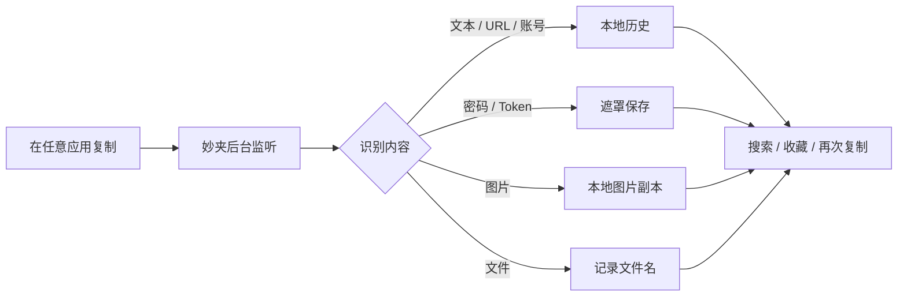

<div align="center">
  
  <h1>妙夹 · MiaoClip</h1>
  <p>一个本地优先、懂内容、可持续使用的桌面剪贴板工作区。</p>
  <p>
    <a href="https://github.com/strawberry-little-bear/miao-clip/actions/workflows/ci.yml"></a>
    
    
    
  </p>
</div>

## 为什么做妙夹

剪贴板是每天都会用到的临时工作区，但复制一次新的内容之后，之前的账号、链接、图片、文件和代码片段就很难找回。妙夹把这些内容自动收进本地历史，让它们可以被理解、搜索、预览和再次复制。

妙夹是一个独立重新实现的项目：保留自动监听、历史记录和再次复制这些必要能力，但不照搬朋友的 `Ctrl-CCCC` 代码，也不试图做成 CopyQ 那种复杂的通用自动化平台。它更适合个人电脑上的日常工作流。

## 核心体验

| 自动收件 | 看得懂 | 用得回 |
| --- | --- | --- |
| 复制后自动捕获文字、链接、账号、密码、图片和文件 | 识别内容类型、敏感状态、来源应用和捕获时间 | 一键复制、显示敏感原文、复制图片或文件、收藏常用记录 |



### 已经可以使用

- **自动捕获**：复制成功后自动写入历史，不需要主动点击“读取当前剪贴板”。
- **本地持久化**：重启电脑或应用后，最近的历史仍然保存在本机。
- **内容识别**：区分普通文本、URL、账号、疑似密码、图片和文件。
- **敏感内容保护**：密码、Token、API Key 等内容在列表和提示中显示为遮罩；点击眼睛按钮可临时显示并复制原文。
- **图片和文件**：图片保留本地预览；文件显示最后的文件名，而不是冗长的完整路径；两者都可以再次复制。
- **来源追踪**：记录来源应用、捕获时间、内容类型、敏感状态和收藏状态。
- **桌面提示**：复制成功后显示可配置的提示浮层，支持开关、位置和持续时间设置；点击提示可以跳转到对应记录。
- **暂停与隐私模式**：暂时停止捕获、通知和新记录写入，适合复制银行卡号、身份证或私人聊天内容。
- **系统托盘**：关闭主窗口后继续后台监听，可从托盘打开妙夹、暂停监听、切换隐私模式或退出程序。
- **开机启动**：可以在设置中开启登录后自动启动。

## 界面与工作方式

妙夹的主界面分成三个清晰区域：

```text
┌──────────────┬──────────────────────────┬────────────────────┐
│ 导航与筛选    │ 剪贴板收件箱              │ 当前记录详情         │
│ 收件箱        │ 搜索 / 类型 / 时间筛选    │ 内容预览             │
│ 收藏          │ 最近复制的内容            │ 来源应用与捕获时间    │
│ 设置          │ 图片、文件、敏感内容      │ 复制 / 收藏 / 删除    │
└──────────────┴──────────────────────────┴────────────────────┘
```

应用图标就是妙夹的品牌标志，同时用于桌面应用、安装包和系统托盘。它位于 [`src-tauri/icons/icon.png`](src-tauri/icons/icon.png)，不同平台的图标资源也统一由 `src-tauri/icons/` 管理。

## 隐私和数据

妙夹没有账号、云同步或远程数据库。默认情况下，剪贴板内容只写入当前设备的 Tauri 应用数据目录：

```text
history.json       历史记录、来源应用、收藏状态和文件元数据
images/            图片的本地 PNG 副本
notifications.json 通知开关、位置和持续时间
```

隐私模式开启后会同时做到：

1. 暂停自动捕获。
2. 不弹桌面通知。
3. 不写入新记录。
4. 关闭隐私模式后恢复之前的监听状态。

敏感内容识别是基于字段名、Token 前缀和文本形态的启发式判断，不是安全产品级别的密码检测。当前历史文件是本地 JSON，并不等同于系统级加密存储；后续会评估接入 macOS Keychain、Windows Credential Manager 和 Linux Secret Service。

## 平台支持

| 平台 | 当前状态 | 备注 |
| --- | --- | --- |
| macOS | 本地开发与构建 | 支持来源应用识别、系统托盘、通知和开机启动 |
| Linux | CI 构建支持 | 来源应用识别依赖桌面环境；优先使用 `xdotool` |
| Windows | CI 构建支持 | 使用 Windows 原生前台窗口和进程 API；由 GitHub Actions 构建验证 |

Windows 版本不依赖 macOS 私有 API。真实 Windows 设备上的 WebView2、剪贴板、系统通知和开机启动仍建议在发布前做一次手工验收。

## 开始开发

### 环境要求

- Rust stable toolchain
- Tauri CLI 2
- 对应平台的 Tauri 桌面依赖

妙夹的前端是原生 HTML、CSS 和 JavaScript，不需要 Node.js、npm 或前端构建链。Tauri 会直接把 `ui/` 作为静态资源打包；后续增加界面功能时，仍然可以直接修改 `ui/`，启动和打包命令不变。

```bash
git clone https://github.com/strawberry-little-bear/miao-clip.git
cd miao-clip
cargo install tauri-cli --version '^2'
cargo tauri dev
```

构建安装包：

```bash
cargo tauri build
```

调试构建：

```bash
cargo tauri build --debug
```

提交前检查：

```bash
cargo fmt --manifest-path src-tauri/Cargo.toml -- --check
cargo check --manifest-path src-tauri/Cargo.toml
cargo test --manifest-path src-tauri/Cargo.toml
git diff --check
```

## 项目结构

```text
MiaoClip/
├── ui/                       原生界面、筛选、详情和通知浮层
├── src-tauri/
│   ├── src/lib.rs            剪贴板监听、识别、持久化、托盘和 Tauri 命令
│   ├── tauri.conf.json       窗口、资源和打包配置
│   ├── capabilities/         Tauri 权限配置
│   └── icons/                妙夹品牌和平台图标
├── .github/workflows/        macOS、Linux、Windows CI 与构建
└── README.md
```

## 路线图

- [x] 本地历史持久化、去重和数量限制
- [x] 自动监听文本、URL、账号、密码、图片和文件
- [x] 图片预览、文件名展示、图片和文件再次复制
- [x] 敏感内容遮罩、临时显示和复制
- [x] 桌面提示、提示位置和持续时间设置
- [x] 暂停监听、隐私模式和系统托盘后台运行
- [x] 来源应用记录和开机启动
- [x] macOS、Linux、Windows CI 构建验证
- [ ] 系统安全存储，减少敏感内容明文落盘
- [ ] 全局快捷键与快速粘贴
- [ ] 根据账号、域名和内容上下文提供可控推荐
- [ ] 更完整的跨平台安装包发布流程

## 参与贡献

欢迎通过 [Issues](https://github.com/strawberry-little-bear/miao-clip/issues) 反馈平台问题、使用场景和功能建议，也欢迎提交小而明确的 Pull Request。

贡献代码时请注意：

1. 不要绕过隐私模式和敏感内容保护边界。
2. 用户可见行为变化要同步更新 README 和测试。
3. 平台专属代码要保留对应的条件编译和 CI 检查。

## 许可证

本项目使用 [MIT License](LICENSE)。

由 `strawberry-little-bear` 创建和维护。
