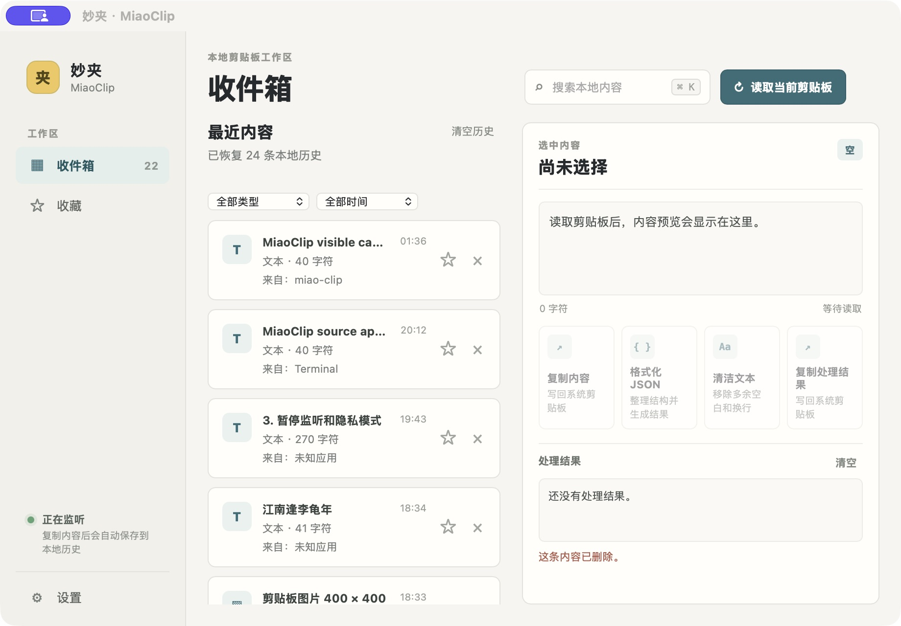
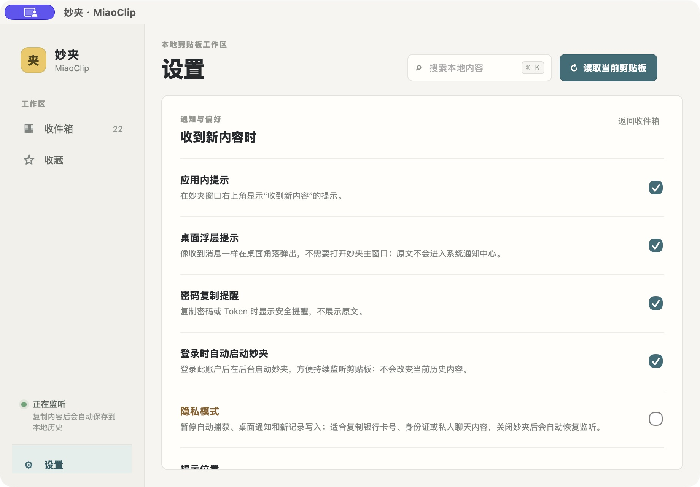
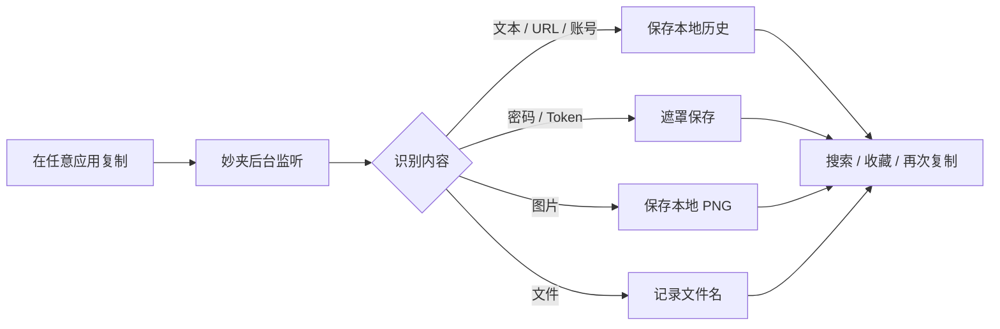

<div align="center">
  

  # 妙夹 · MiaoClip

  <p>把复制过的内容，变成一个真正找得回、看得懂、用得上的本地工作区。</p>

  <p>
    <a href="https://github.com/strawberry-little-bear/miao-clip/actions/workflows/ci.yml"></a>
    
    
    
    
  </p>

  <p>
    <a href="#界面预览">界面预览</a> ·
    <a href="#下载试用版">下载试用版</a> ·
    <a href="#快速开始">快速开始</a> ·
    <a href="#隐私与数据">隐私与数据</a> ·
    <a href="#参与贡献">参与贡献</a>
  </p>
</div>

<p align="center">
  
</p>

> 妙夹是一个本地优先的桌面剪贴板工具。它在后台自动接住复制内容，识别文本、链接、账号、敏感信息、图片和文件，并让这些内容可以被搜索、预览、收藏和再次复制。

## 为什么是妙夹

剪贴板本来就是每天都会使用的临时工作区，但系统默认只保留最后一次复制。妙夹把这段工作流延长一点：

| 自动收集 | 本地整理 | 快速复用 |
| --- | --- | --- |
| 复制后自动捕获文本、URL、账号、图片和文件 | 保存类型、来源应用、时间、敏感状态和收藏状态 | 搜索、预览、显示敏感原文，再次复制或复制处理结果 |

妙夹保留剪贴板历史工具最重要的能力，但定位更克制：它是适合个人电脑的本地小工具，不以云同步、复杂脚本系统或大型自动化平台为目标。项目为独立重新实现，不复制朋友的 `Ctrl-CCCC` 代码，也不使用 CopyQ 的代码或设计。

## 界面预览

### 收件箱：复制过的内容都有来处

收件箱会展示最近捕获的内容，记录内容类型、来源应用和完整日期时间。图片可以直接预览，文件使用最后的文件名展示，敏感内容默认遮罩。

<p align="center">
  
</p>

### 设置：提示、隐私和开机启动都可控

桌面浮层提示可以独立开关，也可以设置是否提醒敏感内容、提示位置和持续时间。隐私模式开启后不会捕获、写入历史或弹出桌面通知，关闭妙夹后会自动恢复监听。

<p align="center">
  
</p>

> 上面的图片来自 macOS 本地 Debug 构建的真实界面，素材保存在 [`docs/images/`](docs/images/)；应用图标来自 [`src-tauri/icons/`](src-tauri/icons/)，也是妙夹的品牌标志和桌面应用图标。

## 核心功能

### 自动捕获

- 后台监听系统剪贴板，复制成功后自动写入本地历史。
- 支持普通文本、URL、账号、疑似密码 / Token / API Key、图片和文件。
- 记录来源应用、完整捕获日期和时间、内容类型、敏感状态和收藏状态。
- 妙夹自己复制内容时会短暂抑制再次捕获，避免历史重复。

### 内容复用

- 搜索本地历史，按内容类型、来源应用和时间筛选；搜索也会匹配来源应用名称。
- 文本、图片和文件都可以再次复制。
- 图片保存为本地 PNG，可在详情区预览。
- 文件展示最后的文件名，而不是冗长的完整路径。
- 支持收藏、删除和清空历史。
- 文本支持格式化 JSON、清洁空白和复制处理结果。

### 敏感内容

- 密码、Token、API Key 等内容在列表和桌面提示中显示为 `********`。
- 点击眼睛按钮后可以临时查看原文。
- 查看原文后仍然可以复制，方便登录和填写表单。
- 敏感识别是启发式判断，不把妙夹当作密码管理器或安全存储使用。

### 暂停与隐私模式

- **正在监听 / 已暂停监听**：一键停止或恢复自动捕获。
- **隐私模式**：暂停自动捕获、不弹桌面通知、不写入新记录。
- 关闭妙夹后，隐私模式不会永久改变用户的监听偏好；下次启动会恢复监听。
- 系统托盘支持打开妙夹、暂停监听、切换隐私模式和退出应用。

### 桌面提示

- 复制成功后显示类似消息提醒的独立浮层，不要求主窗口保持打开。
- 支持设置提示开关、敏感内容提醒、出现位置和持续时间。
- 点击提示可以回到妙夹，并定位到对应的复制记录。
- 原文不会进入系统通知中心，减少敏感内容被其他通知界面暴露的机会。

## 工作方式



## 快速开始

GitHub Actions 会持续检查代码，并为 macOS 和 Windows 自动构建可下载的试用安装包。

### 下载试用版

打开项目的 [Actions 构建记录](https://github.com/strawberry-little-bear/miao-clip/actions/workflows/ci.yml)，进入最近一次成功的 `Build MiaoClip` 运行，在页面底部的 **Artifacts** 区域下载对应平台的产物。macOS Apple Silicon、macOS Intel 和 Windows x64 已在 [2026 年 10 月 30 日的成功构建](https://github.com/strawberry-little-bear/miao-clip/actions/runs/41014467772) 中验证并上传：

| 产物 | 适用设备 | 文件 |
| --- | --- | --- |
| `MiaoClip-macos-arm64` | Apple Silicon Mac（M 系列） | `.dmg` |
| `MiaoClip-macos-x64` | Intel Mac | `.dmg` |
| `MiaoClip-windows-x64` | 64 位 Windows | `.msi` 安装包和 `.exe` 安装程序 |

Actions 产物保留 30 天。这些是方便体验的未签名测试构建，不是正式发布版；macOS 可能提示无法验证开发者，Windows 也可能显示 SmartScreen 提示。请只从本项目的 GitHub Actions 下载，并仅在信任项目来源时运行。当前通过 Actions 运行记录下载，不是 GitHub Releases。

### 运行开发版

环境要求：

- Rust stable toolchain
- Tauri CLI 2
- 对应平台的 Tauri 桌面依赖

```bash
git clone https://github.com/strawberry-little-bear/miao-clip.git
cd miao-clip
cargo install tauri-cli --version '^2'
cargo tauri dev
```

启动后可以这样验证：

1. 在任意应用复制一段文本、一个链接、一张图片或一个文件。
2. 打开妙夹收件箱，确认内容自动出现，并检查来源应用和捕获时间。
3. 点击记录，在详情区预览、收藏或再次复制。
4. 进入设置，测试桌面浮层提示、提示持续时间、暂停监听和隐私模式。

### 构建安装包

```bash
cargo tauri build
```

调试构建：

```bash
cargo tauri build --debug
```

提交前检查：

```bash
cargo fmt --manifest-path src-tauri/Cargo.toml -- --check
cargo check --manifest-path src-tauri/Cargo.toml
cargo test --manifest-path src-tauri/Cargo.toml
git diff --check
```

## 前端与打包说明

妙夹不需要 Node.js、npm 或前端构建链。`ui/` 是原生 HTML、CSS 和 JavaScript 静态资源，Tauri 会直接把它打包进桌面应用。

这意味着后续迭代界面时可以直接修改 `ui/`；需要增加前端依赖或引入复杂构建流程时，再单独评估是否值得引入 Node.js。当前的开发和打包命令保持简单，macOS、Windows 和 Linux 共用同一套静态资源。

## 隐私与数据

妙夹没有账号、云同步或远程数据库。默认情况下，剪贴板内容只写入当前设备的 Tauri 应用数据目录：

```text
history.json        历史记录、来源应用、收藏状态和文件元数据
images/             图片的本地 PNG 副本
notifications.json  通知开关、位置和持续时间
```

密码、Token、API Key 等被识别为敏感内容后，原文不会再写入 `history.json`。妙夹会使用当前系统的安全凭据存储保存正文：macOS 使用 Keychain，Windows 使用 Credential Manager，Linux 使用 Secret Service；历史文件只保存记录元数据和安全存储引用。点击“显示原文”或“复制原文”时，妙夹才会按需读取。

隐私模式开启后会同时做到：

1. 暂停自动捕获。
2. 不弹桌面通知。
3. 不写入新记录。
4. 关闭隐私模式后恢复之前的监听状态。

这项保护减少了敏感内容明文落盘的风险，但妙夹仍然不是完整的密码管理器：敏感识别采用启发式规则，系统账户、密钥环权限和桌面环境仍会影响实际保护效果。

## 平台支持

| 平台 | 当前状态 | 说明 |
| --- | --- | --- |
| macOS | 本地运行与 GitHub Actions 构建已验证 | Actions 提供 Apple Silicon 与 Intel 测试安装包；支持来源应用识别、系统托盘、通知和开机启动 |
| Windows | GitHub Actions 检查与构建已验证 | Actions 提供 64 位 MSI 和 EXE 测试安装包；使用 Windows 原生前台窗口和进程 API，仍建议在真实设备验收 WebView2、通知和开机启动 |
| Linux | GitHub Actions 检查与测试 | 来源应用识别依赖桌面环境，优先使用 `xdotool`；不同桌面环境需要继续实测 |

## 项目结构

```text
miao-clip/
├── ui/                       原生界面、筛选、详情和提示浮层
├── src-tauri/
│   ├── src/lib.rs            剪贴板监听、识别、持久化、托盘和 Tauri 命令
│   ├── tauri.conf.json       窗口、资源和打包配置
│   ├── capabilities/         Tauri 权限配置
│   └── icons/                妙夹品牌和平台图标
├── docs/images/              README 使用的真实界面截图
├── .github/workflows/        macOS、Linux、Windows CI 与构建
└── README.md
```

## 路线图

- [x] 本地历史持久化、去重和数量限制
- [x] 自动监听文本、URL、账号、密码、图片和文件
- [x] 图片预览、文件名展示、图片和文件再次复制
- [x] 敏感内容遮罩、临时显示和复制
- [x] 桌面提示、提示位置和持续时间设置
- [x] 暂停监听、隐私模式和系统托盘后台运行
- [x] 来源应用记录和开机启动
- [x] macOS、Linux、Windows CI 检查；macOS 和 Windows 测试安装包上传为 Actions 产物
- [x] 系统安全存储，减少敏感内容明文落盘
- [ ] 全局快捷键与快速粘贴
- [ ] 根据账号、域名和内容上下文提供可控推荐
- [ ] 更完整的跨平台安装包发布流程

## 参与贡献

欢迎通过 [Issues](https://github.com/strawberry-little-bear/miao-clip/issues) 反馈平台问题、使用场景和功能建议，也欢迎提交小而明确的 Pull Request。

贡献代码时请注意：

1. 不要绕过隐私模式和敏感内容保护边界。
2. 用户可见行为变化要同步更新 README 和测试。
3. 平台专属代码要保留对应的条件编译和 CI 检查。
4. 新增界面功能时，优先保持原生静态资源方案，不要为了小功能引入不必要的构建链。

## 许可证

本项目使用 [MIT License](LICENSE)。

由 `strawberry-little-bear` 创建和维护。
