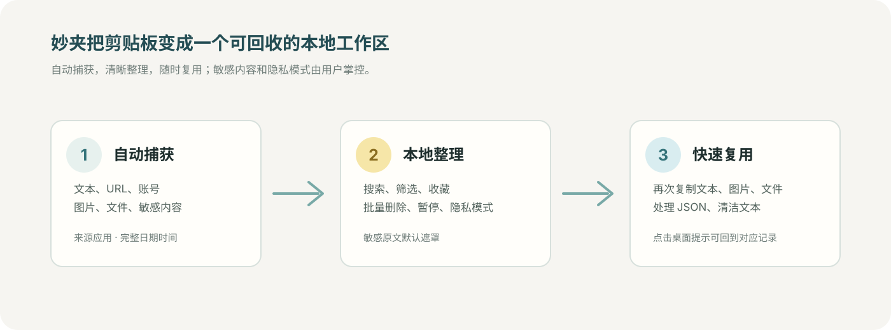
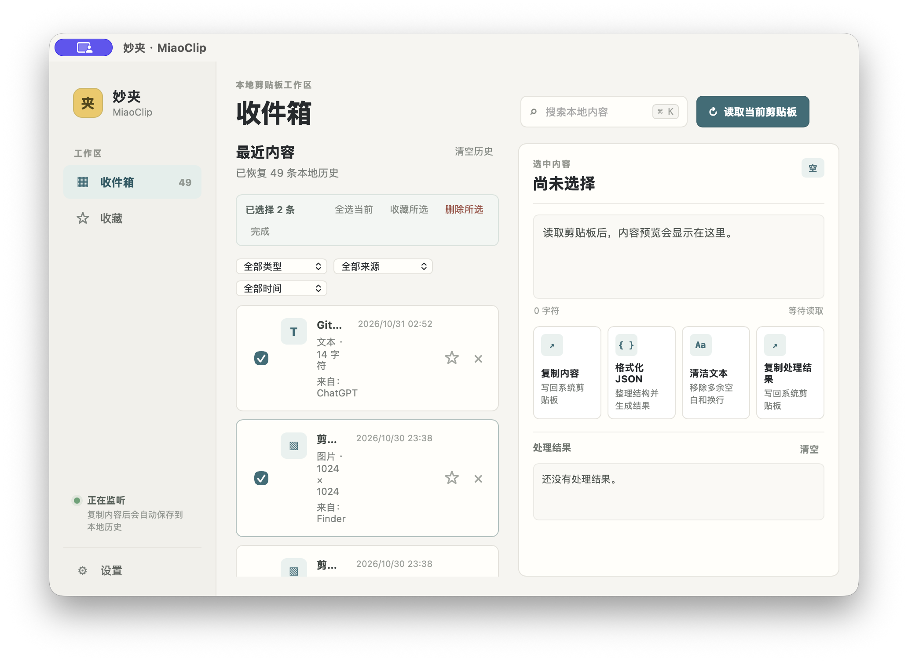
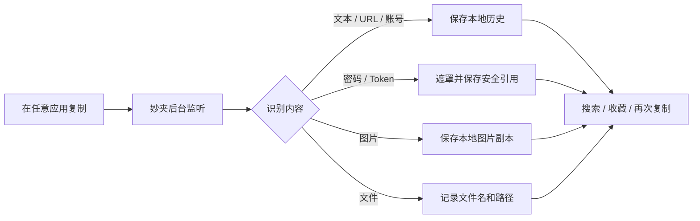

<div align="center">
  

  # 妙夹 · MiaoClip

  <p>把复制过的内容，变成一个找得回、看得懂、用得上的本地工作区。</p>

  <p>
    <a href="https://github.com/strawberry-little-bear/miao-clip/actions/workflows/ci.yml"></a>
    
    
    
    
  </p>

  <p>
    <a href="#30-秒上手">30 秒上手</a> ·
    <a href="#功能速览">功能速览</a> ·
    <a href="#界面预览">界面预览</a> ·
    <a href="#下载试用版">下载试用版</a> ·
    <a href="#隐私与数据">隐私与数据</a> ·
    <a href="#参与贡献">参与贡献</a>
  </p>
</div>

<p align="center">
  
</p>

<p align="center"><sub>复制一次，自动留下来；需要时搜索、预览，再次复制。</sub></p>

> 妙夹是一个本地优先的桌面剪贴板工具。它在后台自动接住复制内容，识别文本、链接、账号、敏感信息、图片和文件，并让这些内容可以被搜索、预览、收藏和再次复制。

## 30 秒上手

妙夹的核心流程只有四步：

```text
复制内容 → 妙夹自动捕获 → 搜索 / 筛选 → 再次复制
```

1. 启动妙夹，并确认左下角显示 **正在监听**。
2. 在任意应用复制文本、URL、图片或文件，妙夹会自动保存到收件箱。
3. 使用搜索框、类型、来源应用或时间筛选找到记录。
4. 点击记录，在右侧预览、收藏、处理或再次复制；需要时可用 **手动读取一次** 作为自动监听的备用入口。

不需要登录，不需要云同步，也不需要 Node.js 前端环境。历史内容默认保存在当前设备；关闭主窗口后，妙夹仍可通过系统托盘继续监听。

## 功能速览

<table>
  <tr>
    <td width="25%"><strong>自动收集</strong><br />后台监听复制内容，文本、URL、账号、图片和文件都能留下。</td>
    <td width="25%"><strong>本地整理</strong><br />按类型、来源应用和完整日期筛选，收藏、批量处理或清理旧历史。</td>
    <td width="25%"><strong>安全查看</strong><br />敏感内容默认遮罩，按需显示或复制原文。</td>
    <td width="25%"><strong>快速复用</strong><br />再次复制内容，或用快速粘贴入口键盘操作。</td>
  </tr>
</table>

<p align="center">
  
</p>

## 为什么是妙夹

系统剪贴板通常只保留最后一次复制，但实际工作中我们经常需要找回几分钟前、几小时前复制过的内容。妙夹把剪贴板变成一个轻量的本地工作区：

| 自动收集 | 本地整理 | 快速复用 |
| --- | --- | --- |
| 后台监听文本、URL、账号、敏感内容、图片和文件 | 保存类型、来源应用、完整日期时间、敏感状态和收藏状态 | 搜索、预览、批量管理，再次复制或复制处理结果 |

妙夹专注于个人电脑上的清晰、可控和低打扰体验，不以云端协作、脚本平台或复杂自动化为目标。

## 你可以用妙夹做什么

| 场景 | 妙夹会怎么处理 |
| --- | --- |
| 文本、URL、账号 | 自动捕获，记录标题、来源、日期和时间，支持搜索与再次复制 |
| 密码、Token、API Key | 列表和桌面提示默认显示为 `********`，点击眼睛按钮后才能查看或复制原文 |
| 图片 | 保存本地图片副本，在详情区预览，也可以再次写回系统剪贴板 |
| 文件 | 保存文件元数据和最后的文件名，避免界面展示冗长路径，也支持再次复制文件 |
| 历史整理 | 收藏、删除、清空，或进入批量选择模式统一处理当前筛选结果 |
| 旧历史清理 | 一键删除指定天数前的未收藏记录，收藏内容保留，其余关联资源同步清理 |
| 临时隐私 | 暂停监听，或开启隐私模式：不捕获、不通知、不写入新记录 |
| 快速复用 | 使用 `⌘/Ctrl + Shift + Space` 打开快速粘贴入口，键盘搜索并写回剪贴板 |

## 界面预览

### 收件箱：每条记录都有来处

收件箱展示内容类型、来源应用、完整日期时间和收藏状态。图片可直接进入详情预览，文件使用最后的文件名，敏感内容默认遮罩。

<p align="center">
  
</p>

### 设置：提示、隐私和开机启动都可控

桌面浮层提示可以独立开关，也可以设置是否提醒敏感内容、出现位置和持续时间。隐私模式开启后不会捕获、写入历史或弹出桌面通知。

<p align="center">
  
</p>

### 批量整理：只处理当前明确选中的内容

进入“批量选择”后，可以全选当前筛选结果、批量收藏或批量删除。搜索和筛选条件变化时，旧的选择会自动清空，避免误操作不可见记录。选择模式下点击整张记录卡片即可勾选，适合连续整理多条历史。

<p align="center">
  
</p>

> 上面的界面图片来自 macOS 本地构建，素材保存在 [`docs/images/`](docs/images/)，应用图标来自 [`src-tauri/icons/`](src-tauri/icons/)，也是妙夹的品牌标志和桌面应用图标。

## 核心功能

### 自动捕获

- 后台监听系统剪贴板，复制成功后自动写入本地历史。
- 支持普通文本、URL、账号、疑似密码 / Token / API Key、图片和文件。
- 记录来源应用、完整捕获日期和时间、内容类型、敏感状态和收藏状态。
- 妙夹自己复制内容时会短暂抑制再次捕获，避免历史重复。

### 搜索、筛选和批量管理

- 搜索会匹配正文、标题、文件名、来源应用和内容类型。
- 支持按类型、来源应用、今天、近 7 天、近 30 天或自定义日期筛选。
- 批量选择只作用于当前明确看到的结果，支持批量收藏 / 取消收藏和批量删除。
- 删除前会二次确认，保存失败时会恢复列表和详情状态。
- 设置中可以清理 7、30、90 天或 1 年前的未收藏记录；收藏内容不会被自动清理。

### 内容复用

- 文本、图片和文件都可以再次复制。
- 图片保存为本地副本，可在详情区预览。
- 文件展示最后的文件名，而不是冗长的完整路径。
- 文本支持格式化 JSON、清洁空白和复制处理结果。

### 敏感内容保护

- 密码、Token、API Key 等内容在列表和桌面提示中显示为 `********`。
- 点击眼睛按钮后可以临时查看原文，查看后仍然可以复制。
- 敏感原文使用当前系统的安全凭据存储，不直接写入历史 JSON。
- 敏感识别采用启发式规则，妙夹不是密码管理器，不能替代专业密钥管理工具。

### 暂停、隐私与通知

- **正在监听 / 已暂停监听**：一键停止或恢复自动捕获。
- **隐私模式**：暂停自动捕获、不弹桌面通知、不写入新记录，关闭后恢复之前的监听状态。
- 支持应用内提示、独立桌面浮层、敏感内容提醒、提示位置和持续时间设置。
- 点击桌面提示可以回到妙夹，并定位到对应的复制记录。
- 系统托盘支持打开妙夹、暂停监听、切换隐私模式和退出应用。

## 工作方式

可以把妙夹理解成三层：**监听层**负责接住系统剪贴板，**整理层**负责保存本地历史和安全引用，**复用层**负责搜索、预览、处理和再次写回系统剪贴板。



## 下载试用版

GitHub Actions 会持续检查代码，并为 macOS 和 Windows 自动构建可下载的试用安装包。

打开项目的 [Actions 构建记录](https://github.com/strawberry-little-bear/miao-clip/actions/workflows/ci.yml)，进入最近一次成功的 `Build MiaoClip` 运行，在页面底部的 **Artifacts** 区域下载对应平台的产物：

| 产物 | 适用设备 | 内容 |
| --- | --- | --- |
| `MiaoClip-macos-arm64` | Apple Silicon Mac（M 系列） | `.dmg` |
| `MiaoClip-macos-x64` | Intel Mac | `.dmg` |
| `MiaoClip-windows-x64` | 64 位 Windows | `.msi` 和 `.exe` |

Actions 产物保留 30 天。这些是方便体验的未签名测试构建，不是正式发布版；macOS 可能提示无法验证开发者，Windows 也可能显示 SmartScreen 提示。请只从本项目的 GitHub Actions 下载，并仅在信任项目来源时运行。

## 开发与构建

### 环境要求

- Rust stable toolchain
- Tauri CLI 2
- 对应平台的 Tauri 桌面依赖

```bash
git clone https://github.com/strawberry-little-bear/miao-clip.git
cd miao-clip
cargo install tauri-cli --version '^2'
cargo tauri dev
```

启动后建议按下面顺序验收：

1. 在任意应用复制文本、链接、图片和文件。
2. 确认内容自动出现在收件箱，并检查来源应用和完整日期时间。
3. 点击记录，测试预览、收藏、再次复制和敏感原文显示。
4. 测试搜索、类型 / 来源 / 日期筛选和批量管理。
5. 进入设置，测试桌面提示、提示持续时间、暂停监听、隐私模式和开机启动。

### 构建安装包

```bash
cargo tauri build
```

调试构建：

```bash
cargo tauri build --debug
```

提交前检查：

```bash
cargo fmt --manifest-path src-tauri/Cargo.toml -- --check
cargo check --manifest-path src-tauri/Cargo.toml
cargo test --manifest-path src-tauri/Cargo.toml
git diff --check
```

### 前端与打包说明

妙夹不需要 Node.js、npm 或前端构建链。`ui/` 是原生 HTML、CSS 和 JavaScript 静态资源，Tauri 会直接把它打包进桌面应用。

后续迭代界面时可以直接修改 `ui/`；需要增加前端依赖或引入复杂构建流程时，再单独评估是否值得引入 Node.js。macOS、Windows 和 Linux 共用同一套静态资源。

## 隐私与数据

妙夹没有账号、云同步或远程数据库。默认情况下，剪贴板内容只写入当前设备的 Tauri 应用数据目录：

```text
history.json        历史记录、来源应用、收藏状态和文件元数据
images/             图片的本地副本
notifications.json  通知开关、位置和持续时间
```

密码、Token、API Key 等被识别为敏感内容后，原文不会再写入 `history.json`。妙夹会使用当前系统的安全凭据存储保存正文：macOS 使用 Keychain，Windows 使用 Credential Manager，Linux 使用 Secret Service；历史文件只保存记录元数据和安全存储引用。点击“显示原文”或“复制原文”时，妙夹才会按需读取。

隐私模式开启后会同时做到：

1. 暂停自动捕获。
2. 不弹桌面通知。
3. 不写入新记录。
4. 关闭隐私模式后恢复之前的监听状态。

这项保护减少了敏感内容明文落盘的风险，但敏感识别采用启发式规则，系统账户、密钥环权限和桌面环境仍会影响实际保护效果。

## 平台支持

| 平台 | 当前状态 | 说明 |
| --- | --- | --- |
| macOS | 本地运行与 GitHub Actions 构建已验证 | Actions 提供 Apple Silicon 与 Intel 测试安装包；支持来源应用识别、系统托盘、通知和开机启动 |
| Windows | GitHub Actions 检查与构建已验证 | Actions 提供 64 位 MSI 和 EXE 测试安装包；仍建议在真实设备验收 WebView2、通知和开机启动 |
| Linux | GitHub Actions 检查与测试 | 来源应用识别依赖桌面环境，优先使用 `xdotool`；不同桌面环境需要继续实测 |

## 项目结构

```text
miao-clip/
├── ui/                       原生界面、筛选、详情和提示浮层
├── src-tauri/
│   ├── src/lib.rs            剪贴板监听、识别、持久化、托盘和 Tauri 命令
│   ├── tauri.conf.json       窗口、资源和打包配置
│   ├── capabilities/         Tauri 权限配置
│   └── icons/                妙夹品牌和平台图标
├── docs/images/              README 使用的真实界面截图
├── .github/workflows/        macOS、Linux、Windows CI 与构建
└── README.md
```

## 路线图

- [x] 本地历史持久化、去重和数量限制
- [x] 自动监听文本、URL、账号、密码、图片和文件
- [x] 图片预览、文件名展示、图片和文件再次复制
- [x] 敏感内容遮罩、临时显示和复制
- [x] 桌面提示、提示位置和持续时间设置
- [x] 暂停监听、隐私模式和系统托盘后台运行
- [x] 来源应用记录和开机启动
- [x] macOS、Linux、Windows CI 检查；macOS 和 Windows 测试安装包上传为 Actions 产物
- [x] 系统安全存储，减少敏感内容明文落盘
- [x] 全局快捷键与可关闭的快速粘贴入口（⌘/Ctrl + Shift + Space）
- [x] 批量选择当前筛选结果、批量收藏 / 取消收藏和批量删除
- [x] 按时间清理旧历史，保留收藏内容并同步清理关联数据
- [ ] Windows 真实设备验收和 Linux 多桌面环境实测
- [ ] 标签和更细粒度的历史整理
- [ ] 定时自动清理规则
- [ ] 历史导出 / 导入
- [ ] 更完整的跨平台安装包发布流程

## 参与贡献

欢迎通过 [Issues](https://github.com/strawberry-little-bear/miao-clip/issues) 反馈平台问题、使用场景和功能建议，也欢迎提交小而明确的 Pull Request。

贡献代码时请注意：

1. 不要绕过隐私模式和敏感内容保护边界。
2. 用户可见行为变化要同步更新 README 和测试。
3. 平台专属代码要保留对应的条件编译和 CI 检查。
4. 新增界面功能时，优先保持原生静态资源方案，不要为了小功能引入不必要的构建链。

## 许可证

本项目使用 [MIT License](LICENSE)。

## 灵感与参考

妙夹是独立开发的本地工具。项目早期在需求讨论和使用场景上参考了朋友的 [Ctrl-CCCC](https://github.com/ylin314/Ctrl-CCCC)，代码、界面和产品实现均独立维护。

由 `strawberry-little-bear` 创建和维护。
